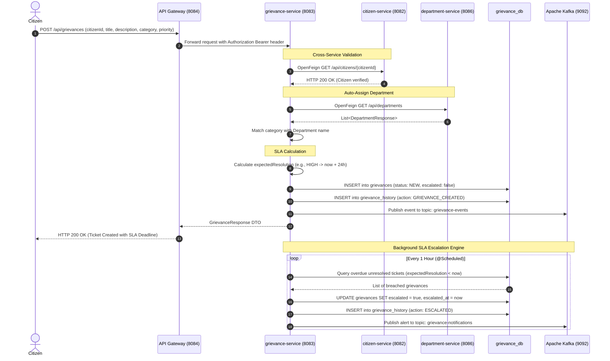
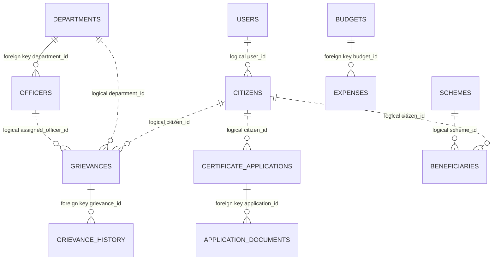

# CivicPulse Nexus

> **Enterprise-grade, cloud-native smart governance platform delivering citizen grievance tracking with SLA enforcement, digital certificate pipelines, welfare disbursement, and municipal analytics.**

[](https://openjdk.org/)
[](https://spring.io/projects/spring-boot)
[](https://spring.io/projects/spring-cloud)
[](https://react.dev/)
[](https://vitejs.dev/)
[](https://www.postgresql.org/)
[](https://www.keycloak.org/)
[](https://kafka.apache.org/)

---

## Quick Navigation

- [1. Project Overview](#1-project-overview)
- [2. SDE Competency Highlights](#2-sde-competency-highlights)
- [3. Feature Matrix & Implementation Status](#3-feature-matrix--implementation-status)
- [4. Verified Technology Stack](#4-verified-technology-stack)
- [5. System Architecture](#5-system-architecture)
  - [Architecture Topology Diagram](#architecture-topology-diagram)
  - [Implemented Workflow Sequence Diagram](#implemented-workflow-sequence-diagram)
- [6. Microservices & Project Structure](#6-microservices--project-structure)
- [7. API Specification Summary](#7-api-specification-summary)
- [8. Database Design & Entity Relationships](#8-database-design--entity-relationships)
- [9. Local Setup & Execution Guide](#9-local-setup--execution-guide)
- [10. Testing, Quality & Build Verification](#10-testing-quality--build-verification)
- [11. Engineering Decisions & Trade-Offs](#11-engineering-decisions--trade-offs)
- [12. Roadmap & Known Limitations](#12-roadmap--known-limitations)
- [13. License & Attribution](#13-license--attribution)
- [Supporting Documentation](#supporting-documentation)

---

## 1. Project Overview

### The Problem
Municipal governance systems often operate through fragmented, paper-heavy workflows across isolated departments (Water, Sanitation, Roads, Electricity). Citizens lack visibility into grievance turnaround times, service certificate issuance is encumbered by physical visits, and municipal administrators struggle to monitor departmental SLA compliance and budget utilization in real time.

### The Solution: CivicPulse Nexus
**CivicPulse Nexus** is a distributed, cloud-native smart governance platform designed to digitize public administration across three core user personas:
1. **Citizens**: File municipal grievances, monitor resolution timelines, apply for birth/death certificates and commercial permits, and enroll in welfare schemes.
2. **Departmental Officers**: Triage assigned grievances through an enforced state machine, verify citizen identity documents, approve certificates, and disburse sanctioned welfare funds.
3. **Municipal Administrators**: Oversee cross-departmental operations, configure department hierarchies, monitor automated SLA escalations, track fiscal budgets, and view city-wide KPI analytics.

### Key Engineering Challenges Solved
- **Strict Data Partitioning**: Replaced monolithic databases with 7 isolated PostgreSQL schemas following the **Database-per-Service** pattern.
- **Cross-Service Security Propagation**: Integrated Keycloak OIDC authentication with declarative OpenFeign request interceptors to forward Bearer JWTs across microservice hops.
- **Stateful Grievance Lifecycle & Auto-Escalation**: Designed a strict state transition machine coupled with a background `@Scheduled` escalation engine that identifies breached SLAs and publishes events via **Apache Kafka**.
- **Resilient KPI Aggregation**: Implemented a stateless API gateway and reporting service utilizing defensive fallback strategies to aggregate real-time municipal health metrics without single-point failure risks.

---

## 2. SDE Competency Highlights

This project demonstrates core backend, distributed systems, and full-stack software development competencies:

- **Microservices Architecture**: Decomposition into 11 discrete Spring Boot services orchestrated via Netflix Eureka (Service Discovery), Spring Cloud Config (Externalized Configuration), and Spring Cloud Gateway (Reactive Edge Ingress).
- **Identity & Access Management (IAM)**: Programmatic Keycloak integration via `KeycloakAdminClient` for citizen registration, password-grant login, and Spring Security OAuth2 Resource Server JWT validation with RBAC (`CITIZEN`, `OFFICER`, `ADMIN`).
- **Distributed Inter-Service Communication**:
  - *Synchronous*: Spring Cloud OpenFeign RPC with `RequestContextHolder` Bearer token propagation.
  - *Asynchronous*: Apache Kafka event streaming for grievance lifecycle events (`grievance-events`) and automated SLA alerts (`grievance-notifications`).
- **Data Modeling & Query Optimization**: Domain-driven relational modeling with JPA/Hibernate, multi-attribute dynamic querying using Spring Data **JPA Specifications** (filtering by keyword, status, category, priority, officer, and due-date), and pagination.
- **Defensive API Design**: Robust exception translation (`FeignExceptionHandler`), standardized error responses (`ApiError`), and resilient fallback aggregations (`safe(supplier)`).
- **Modern Frontend Architecture**: React 19 single-page application built with Vite, featuring custom routing guards (`ProtectedRoute`), centralized JWT session handling, and clean, modular component structures.

---

## 3. Feature Matrix & Implementation Status

To ensure absolute technical accuracy, features are categorized by verified implementation state:

| Functional Area | Feature Description | Implementation Status | Verified Source Modules |
| :--- | :--- | :--- | :--- |
| **Authentication & RBAC** | Keycloak user provisioning, password-grant login, JWT token issuance | Verified | `user-service`, `AuthContext.jsx` |
| **Authentication & RBAC** | Role-based route guards (`CITIZEN`, `OFFICER`, `ADMIN`) | Verified | `ProtectedRoute.jsx`, `App.jsx` |
| **Citizen Profile** | Aadhaar-based demographic registry, user linkage | Verified | `citizen-service` (`CitizenController.java`) |
| **Grievance Management** | Grievance intake with dynamic SLA calculation (24h HIGH, 3d MEDIUM, 7d LOW) | Verified | `grievance-service` (`GrievanceServiceImpl.java`) |
| **Grievance Management** | Category-based auto-department routing via Feign | Verified | `grievance-service` (`autoAssignDepartment`) |
| **Grievance Management** | Multi-attribute search (keyword, status, priority, due-today) & pagination | Verified | `grievance-service` (`GrievanceSpecification.java`) |
| **Grievance Management** | Strict state transition machine (`NEW` → `ASSIGNED` → `IN_PROGRESS` → `RESOLVED` → `CLOSED`) | Verified | `grievance-service` (`isValidTransition`) |
| **Grievance Management** | Immutable audit trail tracking all actions and remarks | Verified | `grievance-service` (`GrievanceHistoryRepository`) |
| **SLA Escalation** | Scheduled hourly scanner (`@Scheduled`) identifying overdue tickets | Verified | `grievance-service` (`GrievanceEscalationScheduler.java`) |
| **Event Streaming** | Kafka publication of grievance creation & SLA breach alerts | Verified | `grievance-service` (`GrievanceNotificationProducer.java`) |
| **Certificate Pipeline** | 9 document/permit workflows (Birth, Death, Income, Trade, Building) | Verified | `service-management-service` (`ServiceType.java`) |
| **Certificate Pipeline** | Multi-stage officer verification, approval, and rejection pipeline | Verified | `service-management-service` (`CertificateService.java`) |
| **Certificate Pipeline** | Dynamic digital signature hashing & official HTML certificate generation | Verified | `service-management-service` (`generate`) |
| **Welfare Schemes** | Public scheme administration and automated eligibility validation | Verified | `welfare-service` (`WelfareController.java`) |
| **Welfare Schemes** | Beneficiary enrollment and voucher disbursement tracking | Verified | `welfare-service` (`disburse`) |
| **Budget & Accounting** | Department budget appropriations and expense outlay tracking | Verified | `budget-service` (`BudgetController.java`) |
| **Governance Dashboard** | Multi-service metrics aggregation with graceful fallback handling | Verified | `reporting-service` (`DashboardService.java`) |
| **Distributed Caching** | Redis caching layer for hot entity reads | Planned / Roadmap | Documented in planning specs; not in active code |
| **Distributed Tracing** | OpenTelemetry / Zipkin distributed trace correlation | Planned / Roadmap | Future production enhancement |

---

## 4. Verified Technology Stack

| Technology | Purpose | Where It Is Used |
| :--- | :--- | :--- |
| **Java 25 (OpenJDK)** | Core Backend Runtime | All 11 microservice modules |
| **Spring Boot 3.5.16** | Application Framework & Dependency Injection | All backend microservices |
| **Spring Cloud 2025.0.3** | Microservices Architecture Suite | Core infrastructure & inter-service RPC |
| **Spring Cloud Gateway** | Reactive Edge Routing & Reverse Proxy | `api-gateway` (Port 8084) |
| **Netflix Eureka** | Dynamic Service Registry & Discovery | `discovery-server` (Port 8761) & all Eureka clients |
| **Spring Cloud Config** | Externalized Centralized Configuration | `config-server` (Port 8888) (`native` profile) |
| **Spring Cloud OpenFeign** | Declarative Synchronous REST Clients | `citizen-service`, `grievance-service`, `reporting-service` |
| **Spring Data JPA / Hibernate**| Object-Relational Mapping & Persistence | 7 core business microservices |
| **PostgreSQL 16** | Relational Database Management System | 7 independent service databases on Port 5432 |
| **Keycloak IAM** | OAuth2 / OpenID Connect Identity Provider | Federated auth server (Port 8080, Realm: `civicpulse`) |
| **Apache Kafka** | Asynchronous Event Streaming & Pub/Sub | `grievance-service` (Port 9092, topics: `grievance-events`, `grievance-notifications`) |
| **Springdoc OpenAPI (Swagger)**| API Documentation & Interactive Exploration | Embedded in domain services (`/swagger-ui.html`) |
| **React 19.2.8** | Client UI Library | `frontend/` single-page application |
| **Vite 8.2.2** | Frontend Build Tool & Dev Server | `frontend/` build toolchain |
| **React Router DOM 7.18.2** | Declarative Client-Side Routing & Guards | `frontend/src/App.jsx` |
| **Oxlint 1.79.0** | High-Performance JavaScript/React Linter | `frontend/` static code analysis (`npm run lint`) |
| **Docker & Docker Compose** | Containerized Local Infrastructure | `docker-compose.yml` (PostgreSQL 16 multi-db orchestration) |

---

## 5. System Architecture

CivicPulse Nexus employs an ingress-routed, service-oriented architecture. All incoming client interactions enter through **Spring Cloud Gateway** (`8084`), which discovers target microservices dynamically from **Eureka Server** (`8761`). Services retrieve their runtime database credentials, topic names, and OAuth2 issuer URLs from **Config Server** (`8888`).

### Architecture Topology Diagram

```mermaid
flowchart TD
    Client["Browser Client (React 19 and Vite 8)"]

    subgraph Ingress["API Gateway Layer"]
        Gateway["Spring Cloud Gateway - Port 8084"]
    end

    subgraph Registry["Discovery and Configuration"]
        Eureka["Eureka Server - Port 8761"]
        Config["Config Server - Port 8888"]
    end

    subgraph Identity["Identity and Access Management"]
        Keycloak["Keycloak IAM - Port 8080 - Realm civicpulse"]
    end

    subgraph Services["Business Microservices"]
        UserSvc["User Service - 8081"]
        CitizenSvc["Citizen Service - 8082"]
        GrievanceSvc["Grievance Service - 8083"]
        DeptSvc["Department Service - 8086"]
        CertSvc["Service Management Service - 8087"]
        WelfareSvc["Welfare Service - 8088"]
        BudgetSvc["Budget Service - 8089"]
        ReportingSvc["Reporting Service - 8090"]
    end

    subgraph Messaging["Event Streaming"]
        Kafka["Apache Kafka - Port 9092"]
    end

    subgraph Persistence["PostgreSQL 16 - Port 5432"]
        DBUser[("user_db")]
        DBCitizen[("citizen_db")]
        DBGrievance[("grievance_db")]
        DBDept[("department_db")]
        DBService[("service_db")]
        DBWelfare[("welfare_db")]
        DBBudget[("budget_db")]
    end

    Client -->|"HTTP REST and Bearer Token"| Gateway

    Gateway -->|"USER-SERVICE"| UserSvc
    Gateway -->|"CITIZEN-SERVICE"| CitizenSvc
    Gateway -->|"GRIEVANCE-SERVICE"| GrievanceSvc
    Gateway -->|"DEPARTMENT-SERVICE"| DeptSvc
    Gateway -->|"SERVICE-MANAGEMENT-SERVICE"| CertSvc
    Gateway -->|"WELFARE-SERVICE"| WelfareSvc
    Gateway -->|"BUDGET-SERVICE"| BudgetSvc
    Gateway -->|"REPORTING-SERVICE"| ReportingSvc

    UserSvc -.->|"Registration and heartbeat"| Eureka
    CitizenSvc -.->|"Registration and heartbeat"| Eureka
    GrievanceSvc -.->|"Registration and heartbeat"| Eureka
    DeptSvc -.->|"Registration and heartbeat"| Eureka
    CertSvc -.->|"Registration and heartbeat"| Eureka
    WelfareSvc -.->|"Registration and heartbeat"| Eureka
    BudgetSvc -.->|"Registration and heartbeat"| Eureka
    ReportingSvc -.->|"Registration and heartbeat"| Eureka
    Gateway -.->|"Dynamic route discovery"| Eureka

    UserSvc -.->|"Fetch configuration"| Config
    CitizenSvc -.->|"Fetch configuration"| Config
    GrievanceSvc -.->|"Fetch configuration"| Config
    DeptSvc -.->|"Fetch configuration"| Config
    CertSvc -.->|"Fetch configuration"| Config
    WelfareSvc -.->|"Fetch configuration"| Config
    BudgetSvc -.->|"Fetch configuration"| Config
    ReportingSvc -.->|"Fetch configuration"| Config

    UserSvc -->|"Admin client and login"| Keycloak
    CitizenSvc -.->|"JWT verification"| Keycloak
    GrievanceSvc -.->|"JWT verification"| Keycloak
    DeptSvc -.->|"JWT verification"| Keycloak

    CitizenSvc -->|"OpenFeign: GET user by ID"| UserSvc
    GrievanceSvc -->|"OpenFeign: GET citizen by ID"| CitizenSvc
    GrievanceSvc -->|"OpenFeign: GET departments and officers"| DeptSvc

    ReportingSvc -->|"Citizen count requests"| CitizenSvc
    ReportingSvc -->|"Grievance report requests"| GrievanceSvc
    ReportingSvc -->|"Budget report requests"| BudgetSvc
    ReportingSvc -->|"Certificate report requests"| CertSvc

    GrievanceSvc -->|"Publish grievance events and SLA breaches"| Kafka
    Kafka -->|"Deliver notification events"| GrievanceSvc

    UserSvc --> DBUser
    CitizenSvc --> DBCitizen
    GrievanceSvc --> DBGrievance
    DeptSvc --> DBDept
    CertSvc --> DBService
    WelfareSvc --> DBWelfare
    BudgetSvc --> DBBudget
```



### Implemented Workflow Sequence Diagram

The following sequence reflects the **Grievance Submission, Auto-Department Assignment, and SLA SLA Escalation** workflow verified in `GrievanceServiceImpl.java` and `GrievanceEscalationScheduler.java`:



---

## 6. Microservices & Project Structure

```
civicpulse/
├── pom.xml                               # Parent Maven Multi-Module Project Descriptor
├── docker-compose.yml                    # Local infrastructure: PostgreSQL 16
├── .env.example                          # Safe environment variable configuration template
├── README.md                             # Primary project portfolio showcase
├── docs/                                 # Deep technical architecture documentation
│   ├── ARCHITECTURE.md                   # In-depth architectural analysis & design choices
│   ├── API.md                            # Comprehensive REST API catalog & payload schemas
│   └── DATABASE.md                       # Database schema definitions & Mermaid ER diagram
├── docker/
│   └── init-databases.sql                # SQL initialization creating 7 microservice databases
│
├── discovery-server/                     # Port 8761: Netflix Eureka Registry
├── config-server/                        # Port 8888: Centralized Config Server
│   └── src/main/resources/config/        # Externalized properties for all microservices
├── api-gateway/                          # Port 8084: Spring Cloud Gateway (WebFlux / Reactive)
│
├── user-service/                         # Port 8081: Identity, Keycloak Admin Client, Auth
├── citizen-service/                      # Port 8082: Citizen demographic profile repository
├── department-service/                   # Port 8086: Department hierarchy & Officer directory
├── grievance-service/                    # Port 8083: Grievance intake, SLA, Kafka messaging
├── service-management-service/           # Port 8087: Certificate/permit issuance & HTML generator
├── welfare-service/                      # Port 8088: Public schemes & automated eligibility rules
├── budget-service/                       # Port 8089: Budget appropriations & expense ledger
├── reporting-service/                    # Port 8090: Stateless KPI aggregation via OpenFeign
│
└── frontend/                             # Port 5173: React 19 + Vite 8 Single-Page App
    ├── package.json                      # Dependencies: React 19, React Router 7, Oxlint
    ├── vite.config.js                    # Vite configuration
    └── src/
        ├── App.jsx                       # Declarative route configuration with ProtectedRoute
        ├── context/                      # AuthContext managing Keycloak JWT token lifecycle
        ├── pages/                        # 20 role-specific pages (Citizen, Officer, Admin)
        ├── components/                   # Reusable UI cards, tables, layout, Navbar, Sidebar
        └── services/                     # Centralized API fetch layer (api.js, grievanceService.js)
```

---

## 7. API Specification Summary

All endpoints are accessible via API Gateway at `http://localhost:8084`. For detailed request/response payloads, refer to [`docs/API.md`](file:///c:/Users/nskab_hoawqow/Desktop/civicpulse/docs/API.md).

| Service | Method | Route Path | Access / Role | Description |
| :--- | :--- | :--- | :--- | :--- |
| **user-service** | `POST` | `/api/users/register` | Public | Registers user in Keycloak and `user_db`. |
| **user-service** | `POST` | `/api/users/login` | Public | Password-grant authentication against Keycloak. |
| **citizen-service** | `POST` | `/api/citizens` | `CITIZEN` | Creates citizen demographic profile linked to user. |
| **citizen-service** | `GET` | `/api/citizens/user/{userId}` | Authenticated | Fetches citizen record for currently logged-in user. |
| **department-service** | `GET` | `/api/departments` | Authenticated | Lists all municipal departments. |
| **department-service** | `POST` | `/api/officers` | `ADMIN` | Provisions municipal officer attached to department. |
| **grievance-service** | `POST` | `/api/grievances` | `CITIZEN` | Submits complaint with auto-department & SLA calculation. |
| **grievance-service** | `GET` | `/api/grievances/search` | Authenticated | Dynamic multi-criteria search (keyword, status, priority, page). |
| **grievance-service** | `PUT` | `/api/grievances/{id}/status/{status}` | `OFFICER`, `ADMIN` | Transitions grievance state according to state machine rules. |
| **grievance-service** | `GET` | `/api/grievances/{id}/history` | Authenticated | Retrieves immutable audit timeline of all transitions. |
| **service-management** | `POST` | `/api/certificates/apply` | `CITIZEN` | Submits application for 9 certificate/permit types. |
| **service-management** | `PUT` | `/api/certificates/{id}/verify` | `OFFICER`, `ADMIN` | Marks submitted supporting documents verified. |
| **service-management** | `POST` | `/api/certificate/generate/{id}`| `OFFICER`, `ADMIN` | Generates digitally signed HTML certificate. |
| **welfare-service** | `POST` | `/api/welfare/apply` | `CITIZEN` | Applies for welfare; auto-evaluates age/income rules. |
| **welfare-service** | `POST` | `/api/welfare/disburse/{id}` | `OFFICER`, `ADMIN` | Disburses financial stipend and records voucher. |
| **budget-service** | `POST` | `/api/budget/{id}/expense` | `ADMIN` | Records expense and increments departmental utilization. |
| **reporting-service** | `GET` | `/api/dashboard` | `ADMIN` | Aggregates municipal KPIs across all domains. |

---

## 8. Database Design & Entity Relationships

CivicPulse Nexus maintains 7 isolated PostgreSQL database schemas to enforce bounded contexts. Complete schemas, columns, constraints, and entity diagrams are documented in [`docs/DATABASE.md`](file:///c:/Users/nskab_hoawqow/Desktop/civicpulse/docs/DATABASE.md).



- **Physical Foreign Keys**: Enforced within individual microservices (`OFFICERS.department_id`, `GRIEVANCE_HISTORY.grievance_id`, `APPLICATION_DOCUMENTS.application_id`).
- **Logical Foreign Keys**: Cross-service linkages (`GRIEVANCES.citizen_id`, `CITIZENS.user_id`) validated via Spring Cloud OpenFeign calls to maintain database isolation.

---

## 9. Local Setup & Execution Guide

### Prerequisites
- **Java**: Java 24 or 25 OpenJDK
- **Build Tool**: Apache Maven 3.9+ (or use the provided `mvnw` wrappers in service directories)
- **Node.js**: v18.0.0+ (with `npm`)
- **Docker**: Docker Engine 24+ & Docker Compose v2+
- **Keycloak**: Keycloak 22+ running on `http://localhost:8080` (Realm: `civicpulse`)
- **Apache Kafka**: Running on `localhost:9092`

---

### Step 1: Initialize PostgreSQL Databases
Start the containerized PostgreSQL instance to automatically create all 7 required databases via `docker/init-databases.sql`:
```bash
docker compose up -d
```
> [!NOTE]
> Ensure port `5432` is available. Configure custom credentials via the template in `.env.example`.

---

### Step 2: Configure Keycloak Realm
1. Open Keycloak Administration Console: `http://localhost:8080`
2. Create Realm named: `civicpulse`
3. Under Realm Roles, create: `CITIZEN`, `OFFICER`, `ADMIN`
4. Create Client named `user-service`:
   - Client authentication: Off
   - Direct access grants: Enabled
5. Verify admin credentials matching `user-service.properties` (or your configured environment overrides).

---

### Step 3: Microservice Startup Sequence
Microservices must be started in topological order to satisfy configuration and discovery dependencies:

```
[1. discovery-server (8761)]
         │
[2. config-server (8888)]
         │
[3. api-gateway (8084)]
         │
[4. Core Services: user-service (8081), citizen-service (8082),
    department-service (8086), grievance-service (8083)]
         │
[5. Extended Services: service-management (8087), welfare (8088),
    budget (8089), reporting-service (8090)]
```

#### Launching Services (Run each in a separate terminal):
```bash
# 1. Discovery Server
cd discovery-server && ./mvnw spring-boot:run

# 2. Config Server (wait for Eureka registration)
cd config-server && ./mvnw spring-boot:run

# 3. API Gateway
cd api-gateway && ./mvnw spring-boot:run

# 4. Core Domain Services
cd user-service && ./mvnw spring-boot:run
cd citizen-service && ./mvnw spring-boot:run
cd department-service && ./mvnw spring-boot:run
cd grievance-service && ./mvnw spring-boot:run

# 5. Extended Domain & Aggregation Services
cd service-management-service && ./mvnw spring-boot:run
cd welfare-service && ./mvnw spring-boot:run
cd budget-service && ./mvnw spring-boot:run
cd reporting-service && ./mvnw spring-boot:run
```

---

### Step 4: Frontend Startup
```bash
cd frontend
npm install
npm run dev
```
The React 19 application will launch at `http://localhost:5173`.

---

### Verified Port Mapping Reference

| Service / Component | Protocol | Verified Port | Health / UI Endpoint |
| :--- | :--- | :--- | :--- |
| **Frontend Application** | HTTP | `5173` | `http://localhost:5173` |
| **API Gateway** | HTTP | `8084` | `http://localhost:8084/actuator/health` |
| **Eureka Discovery Server**| HTTP | `8761` | `http://localhost:8761` |
| **Config Server** | HTTP | `8888` | `http://localhost:8888/actuator/health` |
| **Keycloak IAM** | HTTP | `8080` | `http://localhost:8080/realms/civicpulse` |
| **Apache Kafka Broker** | TCP | `9092` | `localhost:9092` |
| **PostgreSQL 16** | TCP | `5432` | `localhost:5432` |
| **user-service** | HTTP | `8081` | `http://localhost:8081/swagger-ui.html` |
| **citizen-service** | HTTP | `8082` | `http://localhost:8082/swagger-ui.html` |
| **grievance-service** | HTTP | `8083` | `http://localhost:8083/swagger-ui.html` |
| **department-service** | HTTP | `8086` | `http://localhost:8086/swagger-ui.html` |
| **service-management** | HTTP | `8087` | `http://localhost:8087/swagger-ui.html` |
| **welfare-service** | HTTP | `8088` | `http://localhost:8088/actuator/health` |
| **budget-service** | HTTP | `8089` | `http://localhost:8089/actuator/health` |
| **reporting-service** | HTTP | `8090` | `http://localhost:8090/actuator/health` |

---

## 10. Testing, Quality & Build Verification

### Static Analysis & Linter Verification
The frontend code was verified using **Oxlint**:
```bash
cd frontend
npm run lint
```
- **Result**: `0 errors`, `10 warnings` (informational React Hook dependency suggestions) across 36 source files.

### Production Bundle Build Verification
The frontend production packaging was tested using Vite:
```bash
cd frontend
npm run build
```
- **Result**: Built successfully in **1.00s** (57 modules transformed into optimized gzip chunks `index.js: 84.36 kB`, `index.css: 2.87 kB`).

### Backend Test Coverage & Analysis
- **Test Frameworks Present**: JUnit 5, Spring Boot Test (`spring-boot-starter-test`).
- **Implemented Tests**: Default Spring context loading smoke tests (`contextLoads()`) across microservices.
- **Identified Gap / Honest Evaluation**: Unit tests with Mockito and MockMvc integration tests for controllers are not yet comprehensively implemented across all microservice boundaries. This is marked as an active target in the roadmap.

---

## 11. Engineering Decisions & Trade-Offs

1. **Why Database-per-Service?**
   - *Rationale*: Prevents accidental coupling between domains (e.g., budget modifications impacting citizen identity schemas).
   - *Trade-off*: Eliminates relational SQL joins across domains; requires declarative OpenFeign calls and eventual consistency via Kafka.
2. **Why Spring Cloud Gateway over Nginx for Edge Routing?**
   - *Rationale*: Spring Cloud Gateway integrates natively with Netflix Eureka (`lb://SERVICE-NAME`), enabling zero-touch configuration when new service replicas register.
3. **Why Synchronous OpenFeign + RequestInterceptor for Identity Verification?**
   - *Rationale*: When a citizen files a grievance, immediate validation of their citizen record and department availability is required. An asynchronous call would require complex saga compensation logic for an immediate HTTP response.
   - *Implementation*: `FeignClientConfig.java` captures the caller's JWT from `RequestContextHolder` and propagates it on outgoing calls.
4. **Why Scheduled Polling for SLA Escalations?**
   - *Rationale*: Hourly batch scans against indexed timestamp columns (`expectedResolution < now`) provide resilient, idempotent execution that survives service restarts without relying on fragile in-memory timers.

---

## 12. Roadmap & Known Limitations

- [ ] **Distributed Tracing**: Introduce Micrometer Tracing with OpenTelemetry collector to trace requests across Gateway, OpenFeign, and Kafka.
- [ ] **Circuit Breakers**: Embed Resilience4j circuit breakers and rate limiters on all Feign client interfaces.
- [ ] **Comprehensive Test Suites**: Add Mockito unit test suites and Testcontainers integration tests verifying Kafka and PostgreSQL interactions.
- [ ] **Full Container Orchestration**: Package all 11 Spring Boot services into lightweight Alpine/Eclipse-Temurin Docker images orchestrated via Docker Compose and Helm charts.
- [ ] **Transactional Outbox Pattern**: Implement Outbox pattern in `grievance-service` to ensure atomic state updates and Kafka event emissions.

---

## 13. License & Attribution

- **License Status**: Proprietary / All rights reserved. This repository is maintained as an engineering showcase.
- **Author & Maintainer**: CivicPulse Nexus Engineering Team.

---

## Supporting Documentation

- 📘 **[System Architecture & Design Document](file:///c:/Users/nskab_hoawqow/Desktop/civicpulse/docs/ARCHITECTURE.md)**: Detailed component breakdown, security model, and failure recovery.
- 📗 **[REST API Specification](file:///c:/Users/nskab_hoawqow/Desktop/civicpulse/docs/API.md)**: Complete endpoint inventory with request/response schemas.
- 📙 **[Database Architecture & Schemas](file:///c:/Users/nskab_hoawqow/Desktop/civicpulse/docs/DATABASE.md)**: Schemas, column constraints, and complete Mermaid ER diagram.
- ⚙️ **[Environment Configuration Template](file:///c:/Users/nskab_hoawqow/Desktop/civicpulse/.env.example)**: Safe local development environment template.
