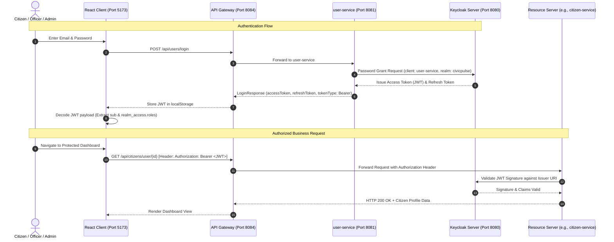
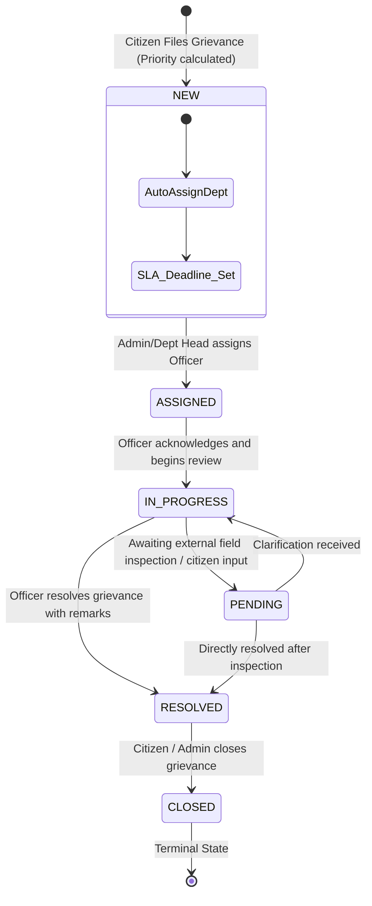
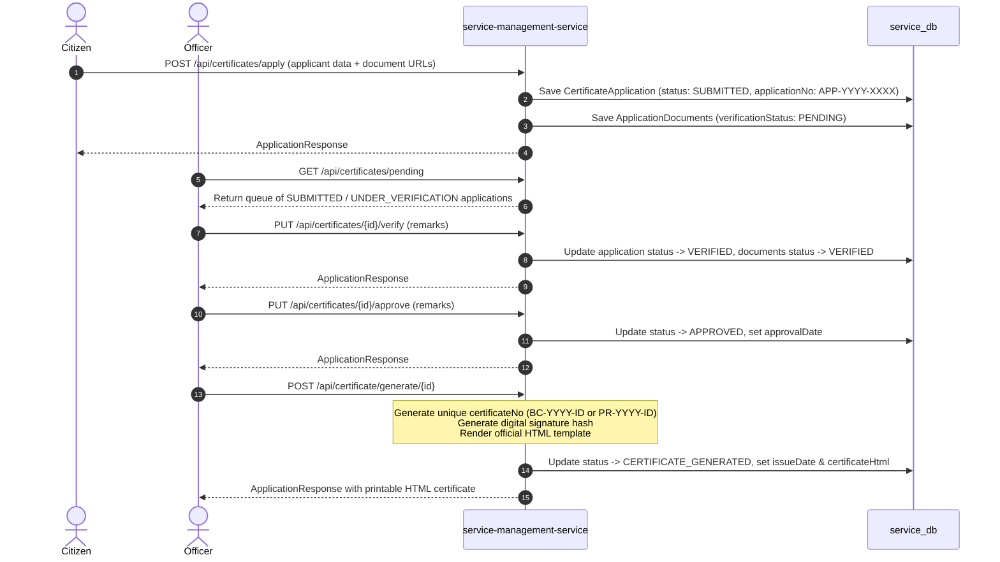

# CivicPulse Nexus — System Architecture & Engineering Design

This document details the software architecture, design principles, component interactions, security model, and engineering decisions implemented across **CivicPulse Nexus**, a cloud-native smart governance and municipal management platform.

---

## 1. Architectural Overview & Design Philosophy

CivicPulse Nexus is architected following a **decoupled, multi-service microservices pattern** built atop Java 25, Spring Boot 3.5.16, Spring Cloud 2025.0.3, and a modern React 19 frontend. The platform replaces fragmented municipal paperwork with a unified digital ecosystem serving three distinct user personas: **Citizens**, **Departmental Officers**, and **Municipal Administrators**.

### Core Architectural Tenets

1. **Database-per-Service Isolation**: Each business service strictly owns its relational database schema within PostgreSQL 16. Services never query another service's database directly.
2. **Centralized Configuration & Discovery**: Dynamic service discovery via Netflix Eureka eliminates hardcoded hostnames, while Spring Cloud Config Server provides externalized, centralized property management.
3. **Single Ingress & Unified Gateway**: Spring Cloud Gateway acts as the single reverse proxy for the frontend application, managing route predicates, CORS policies, and load balancing across service instances.
4. **Federated Identity & Role-Based Access Control (RBAC)**: Keycloak IAM acts as the OAuth2 / OpenID Connect authority, issuing signed JWTs containing realm roles (`CITIZEN`, `OFFICER`, `ADMIN`).
5. **Hybrid Communication (Sync + Async)**:
   - **Synchronous RPC**: Declarative Spring Cloud OpenFeign clients perform low-latency entity lookups (e.g., verifying citizen identity during grievance submission), with automatic Bearer token forwarding.
   - **Asynchronous Event Streaming**: Apache Kafka decouples time-insensitive workflows, event auditing, and scheduled SLA breach notifications.
6. **Resilient Data Aggregation**: The reporting service implements a stateless API aggregator pattern with defensive fallback handling to prevent upstream downtime from impacting executive dashboards.

---

## 2. Microservice Inventory & Responsibility Matrix

The system comprises 11 Maven modules and 1 independent frontend application:

| Service Name | Type | Port | Database | Primary Responsibility & Implemented Scope |
| :--- | :--- | :--- | :--- | :--- |
| **`discovery-server`** | Infrastructure | `8761` | None | Netflix Eureka Service Registry; enables dynamic service location and client-side load balancing. |
| **`config-server`** | Infrastructure | `8888` | None | Centralized externalized configuration repository (`native` profile pointing to `classpath:/config`). |
| **`api-gateway`** | Ingress | `8084` | None | Reactive Spring Cloud Gateway; routing (`/api/**`), global CORS, and load-balanced forwarding (`lb://*`). |
| **`user-service`** | Core Domain | `8081` | `user_db` | User identity lifecycle, Keycloak Admin API integration (user provisioning & role assignment), password-grant authentication. |
| **`citizen-service`** | Core Domain | `8082` | `citizen_db` | Citizen demographic registry (Aadhaar, address, contact details), linked to `user_id`, queried via Feign. |
| **`department-service`** | Core Domain | `8086` | `department_db` | Department hierarchy, municipal officers directory, and officer-to-department assignments. |
| **`grievance-service`** | Core Domain | `8083` | `grievance_db` | Grievance intake, auto-routing by category, SLA calculation, strict status state machine, audit trail, background escalation scheduler, Kafka event producer/consumer. |
| **`service-management-service`**| Core Domain | `8087` | `service_db` | Citizen certificates (birth, death, income, residence) and commercial permits (trade, shop, building); verification pipeline, digital signing, and HTML certificate generator. |
| **`welfare-service`** | Domain | `8088` | `welfare_db` | Public welfare schemes, rule-based beneficiary eligibility validation (age and income constraints), disbursement tracking. |
| **`budget-service`** | Domain | `8089` | `budget_db` | Departmental budget allocations, fiscal period tracking, expense logging, utilization analytics. |
| **`reporting-service`** | Aggregation | `8090` | None | Stateless metrics aggregator querying domain services via OpenFeign with graceful degradation for dashboard KPIs. |
| **`frontend`** | Client Application | `5173` | Browser Storage | React 19 + Vite 8 single-page application with role-protected routing (`CITIZEN`, `OFFICER`, `ADMIN`), responsive layouts, and REST client. |

---

## 3. High-Level System Architecture Diagram

```mermaid

graph TD
    Client["Browser / Citizen and Officer Client (React 19 + Vite)"]

    subgraph Edge["Edge and Routing Layer"]
        Gateway["Spring Cloud Gateway - Port 8084"]
    end

    subgraph Infrastructure["Infrastructure and Registry Layer"]
        Eureka["Eureka Discovery Server - Port 8761"]
        ConfigServer["Spring Cloud Config Server - Port 8888"]
    end

    subgraph Security["Identity and Access Management"]
        Keycloak["Keycloak IAM - Port 8080 - Realm civicpulse"]
    end

    subgraph Services["Business Microservices Layer"]
        UserSvc["User Service - 8081"]
        CitizenSvc["Citizen Service - 8082"]
        GrievanceSvc["Grievance Service - 8083"]
        DeptSvc["Department Service - 8086"]
        CertSvc["Service Management Service - 8087"]
        WelfareSvc["Welfare Service - 8088"]
        BudgetSvc["Budget Service - 8089"]
        ReportingSvc["Reporting Service - 8090"]
    end

    subgraph Messaging["Asynchronous Event Streaming"]
        Kafka["Apache Kafka - Port 9092"]
    end

    subgraph Persistence["PostgreSQL 16 - Port 5432"]
        DBUser[("user_db")]
        DBCitizen[("citizen_db")]
        DBGrievance[("grievance_db")]
        DBDept[("department_db")]
        DBService[("service_db")]
        DBWelfare[("welfare_db")]
        DBBudget[("budget_db")]
    end

    Client -->|"HTTP REST with Bearer JWT"| Gateway

    Gateway -->|"USER-SERVICE"| UserSvc
    Gateway -->|"CITIZEN-SERVICE"| CitizenSvc
    Gateway -->|"GRIEVANCE-SERVICE"| GrievanceSvc
    Gateway -->|"DEPARTMENT-SERVICE"| DeptSvc
    Gateway -->|"SERVICE-MANAGEMENT-SERVICE"| CertSvc
    Gateway -->|"WELFARE-SERVICE"| WelfareSvc
    Gateway -->|"BUDGET-SERVICE"| BudgetSvc
    Gateway -->|"REPORTING-SERVICE"| ReportingSvc

    UserSvc -.->|"Register and heartbeat"| Eureka
    CitizenSvc -.->|"Register and heartbeat"| Eureka
    GrievanceSvc -.->|"Register and heartbeat"| Eureka
    DeptSvc -.->|"Register and heartbeat"| Eureka
    CertSvc -.->|"Register and heartbeat"| Eureka
    WelfareSvc -.->|"Register and heartbeat"| Eureka
    BudgetSvc -.->|"Register and heartbeat"| Eureka
    ReportingSvc -.->|"Register and heartbeat"| Eureka
    Gateway -.->|"Service discovery"| Eureka

    UserSvc -.->|"Fetch configuration"| ConfigServer
    CitizenSvc -.->|"Fetch configuration"| ConfigServer
    GrievanceSvc -.->|"Fetch configuration"| ConfigServer
    DeptSvc -.->|"Fetch configuration"| ConfigServer
    CertSvc -.->|"Fetch configuration"| ConfigServer
    WelfareSvc -.->|"Fetch configuration"| ConfigServer
    BudgetSvc -.->|"Fetch configuration"| ConfigServer
    ReportingSvc -.->|"Fetch configuration"| ConfigServer

    UserSvc -->|"Login and user provisioning"| Keycloak
    CitizenSvc -.->|"JWT validation"| Keycloak
    GrievanceSvc -.->|"JWT validation"| Keycloak
    DeptSvc -.->|"JWT validation"| Keycloak

    CitizenSvc -->|"Fetch user by ID - OpenFeign"| UserSvc
    GrievanceSvc -->|"Fetch citizen by ID - OpenFeign"| CitizenSvc
    GrievanceSvc -->|"Fetch department and officer data"| DeptSvc
    ReportingSvc -->|"Fetch citizen counts"| CitizenSvc
    ReportingSvc -->|"Fetch grievance reports"| GrievanceSvc
    ReportingSvc -->|"Fetch budget reports"| BudgetSvc
    ReportingSvc -->|"Fetch certificate reports"| CertSvc

    GrievanceSvc -->|"Publish grievance events and SLA escalations"| Kafka
    Kafka -->|"Deliver notification events"| GrievanceSvc

    UserSvc --> DBUser
    CitizenSvc --> DBCitizen
    GrievanceSvc --> DBGrievance
    DeptSvc --> DBDept
    CertSvc --> DBService
    WelfareSvc --> DBWelfare
    BudgetSvc --> DBBudget

```



---

## 4. Inter-Service Communication Patterns

### A. Synchronous REST with OpenFeign & Token Propagation

Synchronous inter-service requests are handled using Spring Cloud OpenFeign. To maintain security boundaries without exposing master credentials, the `grievance-service` implements a custom `RequestInterceptor` (`FeignClientConfig.java`):

```java
@Configuration
public class FeignClientConfig {
    @Bean
    public RequestInterceptor requestInterceptor() {
        return requestTemplate -> {
            ServletRequestAttributes attributes = 
                (ServletRequestAttributes) RequestContextHolder.getRequestAttributes();
            if (attributes != null) {
                String authorization = attributes.getRequest().getHeader("Authorization");
                if (authorization != null && !authorization.isBlank()) {
                    requestTemplate.header("Authorization", authorization);
                }
            }
        };
    }
}
```

This ensures that downstream microservice calls carry the caller's verified OAuth2 Bearer token, preserving auditability and role context across service boundaries.

### B. Asynchronous Event-Driven Messaging with Apache Kafka

The grievance lifecycle utilizes Apache Kafka for decoupled notifications and audit logging:

1. **`grievance-events`**: Emitted upon grievance submission (`GrievanceServiceImpl.java` -> `KafkaProducerService.java`) with grievance ID, title, and citizen ID.
2. **`grievance-notifications`**: Emitted when a grievance SLA is breached (`GrievanceEscalationScheduler.java` -> `GrievanceNotificationProducer.java`).
3. **Consumer Verification**: `GrievanceNotificationConsumer.java` listens to `grievance-notifications` within the consumer group `grievance-notification-group`, logging escalation alerts for administrative distribution.

---

## 5. Security & Authentication Architecture



### Identity Lifecycle Details

1. **User Registration**:
   - `POST /api/users/register` triggers `KeycloakServiceImpl.createUser()` via Keycloak Admin REST Client.
   - Sets non-temporary password credentials and assigns the realm role `CITIZEN`.
   - On successful Keycloak creation (`HTTP 201 Created`), extracts Keycloak's unique user GUID from the `Location` header.
   - Persists a corresponding local `User` record in `user_db` with email, names, role, and `keycloak_id`.
2. **Client-Side Authorization**:
   - `AuthContext.jsx` decodes the token payload base64 strings and extracts `realm_access.roles`.
   - `ProtectedRoute.jsx` intercepts client-side routing, restricting paths based on `allowedRoles` (`CITIZEN`, `OFFICER`, `ADMIN`).
3. **Server-Side Validation**:
   - Backend services configure `spring.security.oauth2.resourceserver.jwt.issuer-uri=http://localhost:8080/realms/civicpulse`.
   - Incoming requests without a cryptographically valid token signed by Keycloak are rejected with `HTTP 401 Unauthorized`.

---

## 6. Grievance Management Workflow & SLA State Machine

The grievance lifecycle implements an explicit, enforced state machine with automated SLA calculation and escalation.

### Grievance State Machine



### SLA Resolution Deadlines

Upon creation in `GrievanceServiceImpl.java`, expected resolution times are stamped based on priority:
- **`Priority.HIGH`**: Current timestamp + **24 hours**
- **`Priority.MEDIUM`**: Current timestamp + **3 days**
- **`Priority.LOW`**: Current timestamp + **7 days**

### Automated Escalation Engine

`GrievanceEscalationScheduler.java` runs on an hourly schedule (`@Scheduled(fixedRate = 3600000)`):
1. Queries `grievanceRepository.findByExpectedResolutionBeforeAndEscalatedFalseAndStatusNotIn(now, [RESOLVED, CLOSED])`.
2. Sets `escalated = true` and records timestamp `escalatedAt = now`.
3. Inserts an immutable audit record into `grievance_history` with action `ESCALATED`.
4. Dispatches an escalation message to Kafka topic `grievance-notifications`.

---

## 7. Certificate & Permit Verification Lifecycle

The `service-management-service` handles 9 distinct municipal certificate and permit types:
- **Certificates**: `BIRTH_CERTIFICATE`, `DEATH_CERTIFICATE`, `INCOME_CERTIFICATE`, `RESIDENCE_CERTIFICATE`, `MARRIAGE_CERTIFICATE`
- **Permits & Licenses**: `TRADE_LICENSE`, `SHOP_LICENSE`, `BUILDING_PERMIT`, `WATER_CONNECTION_PERMIT`



---

## 8. Resilience, Fault Tolerance & Error Handling

### A. Defensive API Aggregation (`reporting-service`)

`reporting-service` aggregates metrics across `citizen-service`, `grievance-service`, `budget-service`, and `service-management-service`. To prevent a failure in any one downstream domain from crashing the entire municipal dashboard, `DashboardService.java` wraps calls in a supplier-safe fallback pattern:

```java
private Map<String, Object> safe(java.util.function.Supplier<Map<String, Object>> supplier) {
    try {
        Map<String, Object> value = supplier.get();
        return value == null ? Map.of() : value;
    } catch (Exception ex) {
        return Map.of(); // Return empty map fallback on downstream timeout or network fault
    }
}
```

### B. Upstream Feign Error Translation

In `grievance-service` and `citizen-service`, `FeignExceptionHandler` intercepts `feign.FeignException`:
- `404 Not Found` responses from remote services are re-thrown as domain-specific `ResourceNotFoundException`.
- Connection drops and internal server errors are normalized to a clean `ResponseStatusException(HttpStatus.INTERNAL_SERVER_ERROR, "Error communicating with another service")`.

### C. Standardized Error Payload Format

All core services employ `@RestControllerAdvice` global exception handlers mapping domain exceptions to a structured `ApiError` format:
```json
{
  "timestamp": "2026-10-23T10:15:00",
  "status": 404,
  "error": "Not Found",
  "message": "Grievance not found with id : 101",
  "path": "/api/grievances/101"
}
```

---

## 9. Architectural Trade-offs & Engineering Decisions

| Architectural Decision | Chosen Pattern | Evaluated Alternative | Trade-off Rationale |
| :--- | :--- | :--- | :--- |
| **Data Partitioning** | Database-per-service (7 separate DBs) | Shared Monolithic Database | **Pro**: Strict encapsulation, isolated schemas, zero lock contention between domains.<br/>**Con**: No database-level foreign key constraints across microservices; requires logical ID references and manual data integrity checks over REST. |
| **Configuration** | Spring Cloud Config Server (`native` profile) | Environment variables injected per container | **Pro**: Single source of truth for all 11 services; centralized changes to Kafka topics, ports, and datasource URLs.<br/>**Con**: Centralized point of failure during startup; Config Server must be healthy before domain services boot. |
| **Service Discovery** | Netflix Eureka Server | Static Kubernetes DNS / Docker network aliases | **Pro**: Lightweight local development; automatic client-side load balancing via Spring Cloud `lb://` abstraction without cluster requirements.<br/>**Con**: Heartbeat polling overhead; registry propagation delays (~30 seconds) on service restart. |
| **Synchronous RPC** | Declarative OpenFeign clients with Header Interceptor | Raw WebClient / RestTemplate | **Pro**: Clean, type-safe Java interfaces matching target REST contracts; centralized token forwarding via `RequestInterceptor`.<br/>**Con**: Introduces temporal coupling between caller and callee services during synchronous validation. |
| **SLA Escalation** | Scheduled polling with Kafka event publication | Real-time distributed timers (e.g., Quartz / temporal workflows) | **Pro**: Robust, idempotent polling against database indexes; unaffected by service restarts or memory loss.<br/>**Con**: Hourly polling batch granularity means escalations fire on schedule ticks rather than the exact millisecond of deadline expiration. |

---

## 10. Architectural Limitations & Production Roadmap

1. **Distributed Tracing & Telemetry**: Services currently output logs directly to stdout. Implementing **Micrometer Tracing** with OpenTelemetry / Zipkin would provide distributed trace propagation across Feign calls and Kafka hops.
2. **Circuit Breaker Integration**: Feign clients currently use defensive try-catch error translation. Integrating **Resilience4j** circuit breakers and rate limiters would provide automated fallback degradation during partial outages.
3. **Containerized Multi-Service Deployment**: While PostgreSQL is orchestrated via `docker-compose.yml`, individual microservices run as standalone JARs. Containerizing each service with multi-stage Dockerfiles and updating Docker Compose is the logical next infrastructure milestone.
4. **Kafka Event Idempotency**: Implementing transactional outbox patterns for grievance creation would ensure atomic consistency between database commits and Kafka message dispatches.
