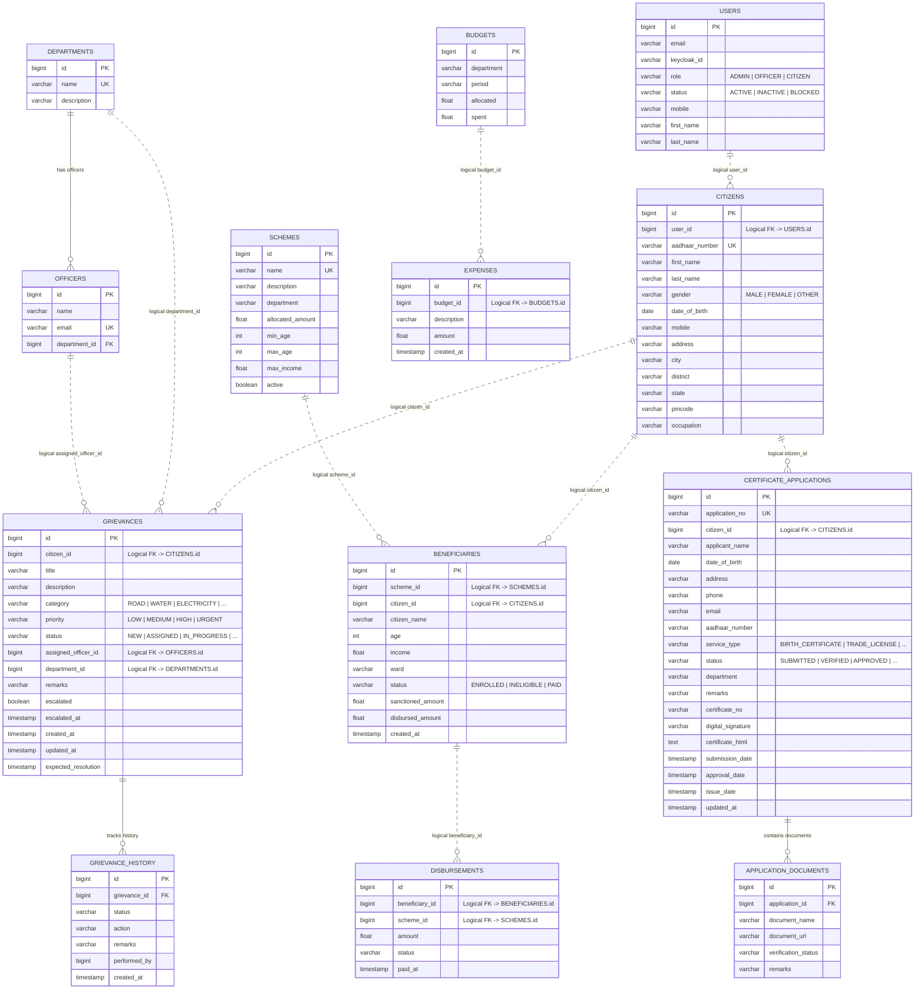

# CivicPulse Nexus — Database Architecture & Schema Design

This document details the database architecture, schema definitions, constraints, entity relationships, and data ownership boundaries across **CivicPulse Nexus**.

---

## 1. Database-per-Service Pattern

CivicPulse Nexus strictly enforces the **Database-per-Service** architectural pattern across PostgreSQL 16. Each business microservice owns its independent database schema:

```
PostgreSQL Instance (Port 5432)
├── user_db         --> Owned exclusively by user-service
├── citizen_db      --> Owned exclusively by citizen-service
├── grievance_db    --> Owned exclusively by grievance-service
├── department_db   --> Owned exclusively by department-service
├── service_db      --> Owned exclusively by service-management-service
├── welfare_db      --> Owned exclusively by welfare-service
└── budget_db       --> Owned exclusively by budget-service
```

### Architectural Guarantees & Trade-offs

1. **Zero Coupling**: No service directly reads from or writes to another service's tables.
2. **Independent Scalability**: Schemas can be migrated, tuned, backed up, or horizontally scaled without touching neighboring services.
3. **Logical vs. Physical References**:
   - Relationships within the same microservice enforce **physical foreign key constraints** (e.g., `officers.department_id` -> `departments.id`).
   - Cross-service relationships use **logical foreign keys** (e.g., `grievances.citizen_id` refers to `citizens.id` in `citizen_db`). Cross-service data validity is enforced at the application tier via OpenFeign calls (`citizenServiceClient.getCitizenById()`).

---

## 2. Complete Entity-Relationship (ER) Diagram



---

## 3. Schema Definitions by Database

### Database 1: `user_db`

Managed by: `user-service`

#### Table: `users`
| Column | Type | Constraints | Description |
| :--- | :--- | :--- | :--- |
| `id` | `BIGINT` | `PRIMARY KEY GENERATED ALWAYS AS IDENTITY` | Internal user surrogate primary key. |
| `email` | `VARCHAR(255)` | `NOT NULL` | User email identifier (unique in Keycloak). |
| `keycloak_id` | `VARCHAR(255)` | `NULLABLE` | UUID of user created in Keycloak realm. |
| `role` | `VARCHAR(50)` | `NOT NULL` | Enum: `ADMIN`, `OFFICER`, `CITIZEN`. |
| `status` | `VARCHAR(50)` | `NOT NULL` | Enum: `ACTIVE`, `INACTIVE`, `BLOCKED`. |
| `mobile` | `VARCHAR(20)` | `NOT NULL` | Primary mobile contact. |
| `first_name` | `VARCHAR(100)` | `NOT NULL` | First name. |
| `last_name` | `VARCHAR(100)` | `NOT NULL` | Last name. |

---

### Database 2: `citizen_db`

Managed by: `citizen-service`

#### Table: `citizens`
| Column | Type | Constraints | Description |
| :--- | :--- | :--- | :--- |
| `id` | `BIGINT` | `PRIMARY KEY GENERATED ALWAYS AS IDENTITY` | Citizen record primary key. |
| `user_id` | `BIGINT` | `NOT NULL` | Logical reference to `users.id` in `user_db`. |
| `aadhaar_number`| `VARCHAR(20)` | `NOT NULL, UNIQUE` | Unique 12-digit national identity number. |
| `first_name` | `VARCHAR(100)` | `NOT NULL` | Given name. |
| `last_name` | `VARCHAR(100)` | `NOT NULL` | Family name. |
| `gender` | `VARCHAR(20)` | `NOT NULL` | Enum: `MALE`, `FEMALE`, `OTHER`. |
| `date_of_birth`| `DATE` | `NOT NULL` | Birth date used for age verification. |
| `mobile` | `VARCHAR(20)` | `NOT NULL` | Citizen mobile contact. |
| `address` | `VARCHAR(255)` | `NOT NULL` | Street address. |
| `city` | `VARCHAR(100)` | `NOT NULL` | City name. |
| `district` | `VARCHAR(100)` | `NOT NULL` | Administrative district. |
| `state` | `VARCHAR(100)` | `NOT NULL` | State jurisdiction. |
| `pincode` | `VARCHAR(20)` | `NOT NULL` | Postal code. |
| `occupation` | `VARCHAR(100)` | `NOT NULL` | Employment or trade. |

---

### Database 3: `department_db`

Managed by: `department-service`

#### Table: `departments`
| Column | Type | Constraints | Description |
| :--- | :--- | :--- | :--- |
| `id` | `BIGINT` | `PRIMARY KEY GENERATED ALWAYS AS IDENTITY` | Department primary key. |
| `name` | `VARCHAR(255)` | `NOT NULL, UNIQUE` | Department name (e.g., WATER, ROAD, SANITATION). |
| `description` | `VARCHAR(255)` | `NULLABLE` | Functional mandate of the department. |

#### Table: `officers`
| Column | Type | Constraints | Description |
| :--- | :--- | :--- | :--- |
| `id` | `BIGINT` | `PRIMARY KEY GENERATED ALWAYS AS IDENTITY` | Officer primary key. |
| `name` | `VARCHAR(255)` | `NOT NULL` | Officer full name. |
| `email` | `VARCHAR(255)` | `NOT NULL, UNIQUE` | Officer official email (matches Keycloak login). |
| `department_id`| `BIGINT` | `FOREIGN KEY REFERENCES departments(id)` | Physical relationship to parent Department. |

---

### Database 4: `grievance_db`

Managed by: `grievance-service`

#### Table: `grievances`
| Column | Type | Constraints | Description |
| :--- | :--- | :--- | :--- |
| `id` | `BIGINT` | `PRIMARY KEY GENERATED ALWAYS AS IDENTITY` | Grievance ticket number. |
| `citizen_id` | `BIGINT` | `NOT NULL` | Logical reference to `citizens.id`. |
| `title` | `VARCHAR(255)` | `NOT NULL` | Brief grievance summary. |
| `description` | `VARCHAR(1000)`| `NOT NULL` | Detailed complaint narrative. |
| `category` | `VARCHAR(50)` | `NOT NULL` | Enum: `ROAD`, `WATER`, `ELECTRICITY`, `SANITATION`, `DRAINAGE`, `STREET_LIGHT`, `GARBAGE`, `OTHER`. |
| `priority` | `VARCHAR(50)` | `NOT NULL` | Enum: `LOW`, `MEDIUM`, `HIGH`, `URGENT`. |
| `status` | `VARCHAR(50)` | `NOT NULL` | Enum: `NEW`, `ASSIGNED`, `IN_PROGRESS`, `PENDING`, `RESOLVED`, `CLOSED`. |
| `assigned_officer_id`| `BIGINT`| `NULLABLE` | Logical reference to `officers.id`. |
| `department_id` | `BIGINT` | `NULLABLE` | Logical reference to `departments.id`. |
| `remarks` | `VARCHAR(255)` | `NULLABLE` | Officer resolution notes. |
| `escalated` | `BOOLEAN` | `NOT NULL DEFAULT FALSE` | Flag set when SLA deadline is breached. |
| `escalated_at` | `TIMESTAMP` | `NULLABLE` | Timestamp when automated escalation fired. |
| `created_at` | `TIMESTAMP` | `NOT NULL` | Creation timestamp (`@CreationTimestamp`). |
| `updated_at` | `TIMESTAMP` | `NOT NULL` | Last modified timestamp (`@UpdateTimestamp`). |
| `expected_resolution`| `TIMESTAMP`| `NULLABLE` | Calculated SLA target (e.g. +24h for HIGH). |

#### Table: `grievance_history`
| Column | Type | Constraints | Description |
| :--- | :--- | :--- | :--- |
| `id` | `BIGINT` | `PRIMARY KEY GENERATED ALWAYS AS IDENTITY` | History event ID. |
| `grievance_id` | `BIGINT` | `NOT NULL` | Reference to parent grievance. |
| `status` | `VARCHAR(50)` | `NOT NULL` | Grievance status at this step. |
| `action` | `VARCHAR(100)` | `NOT NULL` | Event action (e.g. `GRIEVANCE_CREATED`, `OFFICER_ASSIGNED`, `STATUS_CHANGED`, `ESCALATED`). |
| `remarks` | `VARCHAR(1000)`| `NULLABLE` | Explanatory note for the transition. |
| `performed_by` | `BIGINT` | `NULLABLE` | User ID of the actor initiating the change. |
| `created_at` | `TIMESTAMP` | `NOT NULL` | Timestamp of state transition. |

---

### Database 5: `service_db`

Managed by: `service-management-service`

#### Table: `certificate_applications`
| Column | Type | Constraints | Description |
| :--- | :--- | :--- | :--- |
| `id` | `BIGINT` | `PRIMARY KEY GENERATED ALWAYS AS IDENTITY` | Application primary key. |
| `application_no` | `VARCHAR(100)` | `NOT NULL, UNIQUE` | Formatted number (`APP-YYYY-XXXX`). |
| `citizen_id` | `BIGINT` | `NOT NULL` | Logical reference to `citizens.id`. |
| `applicant_name` | `VARCHAR(255)` | `NOT NULL` | Citizen applicant name. |
| `date_of_birth` | `DATE` | `NULLABLE` | Verified birth date. |
| `address` | `VARCHAR(255)` | `NULLABLE` | Applicant residential address. |
| `phone` | `VARCHAR(20)` | `NULLABLE` | Contact phone. |
| `email` | `VARCHAR(255)` | `NULLABLE` | Contact email. |
| `aadhaar_number` | `VARCHAR(20)` | `NULLABLE` | National ID. |
| `service_type` | `VARCHAR(50)` | `NOT NULL` | Enum: `BIRTH_CERTIFICATE`, `DEATH_CERTIFICATE`, `INCOME_CERTIFICATE`, `RESIDENCE_CERTIFICATE`, `MARRIAGE_CERTIFICATE`, `TRADE_LICENSE`, `SHOP_LICENSE`, `BUILDING_PERMIT`, `WATER_CONNECTION_PERMIT`. |
| `status` | `VARCHAR(50)` | `NOT NULL` | Enum: `SUBMITTED`, `UNDER_VERIFICATION`, `VERIFIED`, `APPROVED`, `REJECTED`, `CERTIFICATE_GENERATED`. |
| `department` | `VARCHAR(100)` | `NULLABLE` | Responsible department (defaults to Revenue). |
| `remarks` | `VARCHAR(255)` | `NULLABLE` | Officer verification remarks. |
| `certificate_no` | `VARCHAR(100)` | `NULLABLE` | Formal issued document code (`BC-YYYY-ID` or `PR-YYYY-ID`). |
| `digital_signature`| `VARCHAR(255)` | `NULLABLE` | Hash signature (`DIGITALLY-SIGNED-CIVICPULSE-{id}`). |
| `certificate_html` | `TEXT` | `NULLABLE` | Formatted official HTML document string. |
| `submission_date` | `TIMESTAMP` | `NULLABLE` | Application timestamp. |
| `approval_date` | `TIMESTAMP` | `NULLABLE` | Date approved by officer. |
| `issue_date` | `TIMESTAMP` | `NULLABLE` | Date certificate generated. |
| `updated_at` | `TIMESTAMP` | `NULLABLE` | Last modification time. |

#### Table: `application_documents`
| Column | Type | Constraints | Description |
| :--- | :--- | :--- | :--- |
| `id` | `BIGINT` | `PRIMARY KEY GENERATED ALWAYS AS IDENTITY` | Document record ID. |
| `application_id` | `BIGINT` | `NOT NULL` | Reference to parent application. |
| `document_name` | `VARCHAR(255)` | `NOT NULL` | Name (e.g., Hospital Birth Slip). |
| `document_url` | `VARCHAR(4000)`| `NULLABLE` | Storage URL for uploaded document. |
| `verification_status`| `VARCHAR(50)` | `NULLABLE` | Status (`PENDING`, `VERIFIED`). |
| `remarks` | `VARCHAR(255)` | `NULLABLE` | Verification feedback. |

---

### Database 6: `welfare_db`

Managed by: `welfare-service`

#### Table: `schemes`
| Column | Type | Constraints | Description |
| :--- | :--- | :--- | :--- |
| `id` | `BIGINT` | `PRIMARY KEY GENERATED ALWAYS AS IDENTITY` | Scheme ID. |
| `name` | `VARCHAR(255)` | `NOT NULL, UNIQUE` | Scheme title. |
| `description` | `VARCHAR(255)` | `NULLABLE` | Objective and benefits. |
| `department` | `VARCHAR(100)` | `NULLABLE` | Sponsoring department. |
| `allocated_amount`| `DOUBLE PRECISION`| `NULLABLE` | Total budget pool for this scheme. |
| `min_age` | `INTEGER` | `NULLABLE` | Minimum age required for eligibility. |
| `max_age` | `INTEGER` | `NULLABLE` | Maximum age limit (if any). |
| `max_income` | `DOUBLE PRECISION`| `NULLABLE` | Maximum annual household income limit. |
| `active` | `BOOLEAN` | `NOT NULL DEFAULT TRUE` | Active enrollment toggle. |

#### Table: `beneficiaries`
| Column | Type | Constraints | Description |
| :--- | :--- | :--- | :--- |
| `id` | `BIGINT` | `PRIMARY KEY GENERATED ALWAYS AS IDENTITY` | Beneficiary enrollment ID. |
| `scheme_id` | `BIGINT` | `NOT NULL` | Logical reference to `schemes.id`. |
| `citizen_id` | `BIGINT` | `NOT NULL` | Logical reference to `citizens.id`. |
| `citizen_name` | `VARCHAR(255)` | `NULLABLE` | Beneficiary name. |
| `age` | `INTEGER` | `NULLABLE` | Age at time of application. |
| `income` | `DOUBLE PRECISION`| `NULLABLE` | Declared annual income. |
| `ward` | `VARCHAR(100)` | `NULLABLE` | Municipal ward. |
| `status` | `VARCHAR(50)` | `NULLABLE` | `ENROLLED`, `INELIGIBLE`, `PARTIAL`, `PAID`. |
| `sanctioned_amount`| `DOUBLE PRECISION`| `NULLABLE` | Approved financial stipend. |
| `disbursed_amount` | `DOUBLE PRECISION`| `NULLABLE` | Amount paid out to date. |
| `created_at` | `TIMESTAMP` | `NULLABLE` | Enrollment timestamp. |

#### Table: `disbursements`
| Column | Type | Constraints | Description |
| :--- | :--- | :--- | :--- |
| `id` | `BIGINT` | `PRIMARY KEY GENERATED ALWAYS AS IDENTITY` | Disbursement voucher ID. |
| `beneficiary_id`| `BIGINT` | `NULLABLE` | Logical reference to `beneficiaries.id`. |
| `scheme_id` | `BIGINT` | `NULLABLE` | Logical reference to `schemes.id`. |
| `amount` | `DOUBLE PRECISION`| `NULLABLE` | Disbursed tranche amount. |
| `status` | `VARCHAR(50)` | `NULLABLE` | Payment status (`PAID`). |
| `paid_at` | `TIMESTAMP` | `NULLABLE` | Disbursement execution time. |

---

### Database 7: `budget_db`

Managed by: `budget-service`

#### Table: `budgets`
| Column | Type | Constraints | Description |
| :--- | :--- | :--- | :--- |
| `id` | `BIGINT` | `PRIMARY KEY GENERATED ALWAYS AS IDENTITY` | Budget record ID. |
| `department` | `VARCHAR(255)` | `NOT NULL` | Municipal department. |
| `period` | `VARCHAR(100)` | `NULLABLE` | Fiscal cycle (e.g., `FY 2026-27`). |
| `allocated` | `DOUBLE PRECISION`| `NULLABLE` | Approved budget appropriation. |
| `spent` | `DOUBLE PRECISION`| `NULLABLE` | Cumulative expenditure to date. |

#### Table: `expenses`
| Column | Type | Constraints | Description |
| :--- | :--- | :--- | :--- |
| `id` | `BIGINT` | `PRIMARY KEY GENERATED ALWAYS AS IDENTITY` | Expense ledger ID. |
| `budget_id` | `BIGINT` | `NOT NULL` | Logical reference to `budgets.id`. |
| `description` | `VARCHAR(255)` | `NULLABLE` | Purpose of expenditure. |
| `amount` | `DOUBLE PRECISION`| `NULLABLE` | Outlay amount. |
| `created_at` | `TIMESTAMP` | `NULLABLE` | Recorded timestamp. |

---

## 4. Database Initialization & Hibernate Management

- **Docker Entrypoint**: `docker/init-databases.sql` executes on initial container initialization:
  ```sql
  CREATE DATABASE user_db;
  CREATE DATABASE citizen_db;
  CREATE DATABASE grievance_db;
  CREATE DATABASE department_db;
  CREATE DATABASE service_db;
  CREATE DATABASE welfare_db;
  CREATE DATABASE budget_db;
  ```
- **Hibernate DDL Configuration**:
  ```properties
  spring.jpa.hibernate.ddl-auto=update
  spring.jpa.show-sql=true
  spring.jpa.properties.hibernate.format_sql=true
  ```
  On microservice startup, Hibernate automatically creates and alters tables, primary keys, indexes, and column types to match the JPA entity models.
